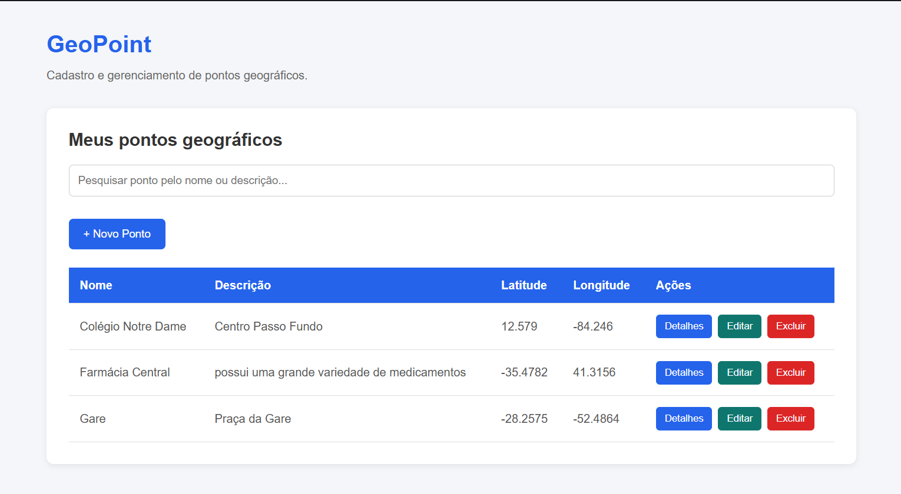
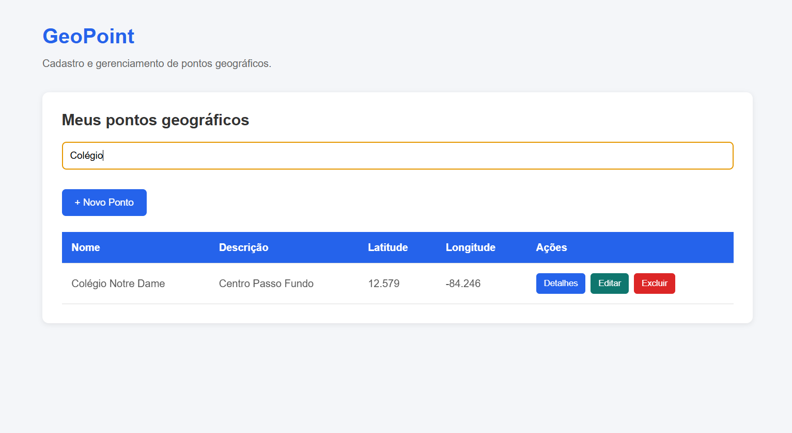
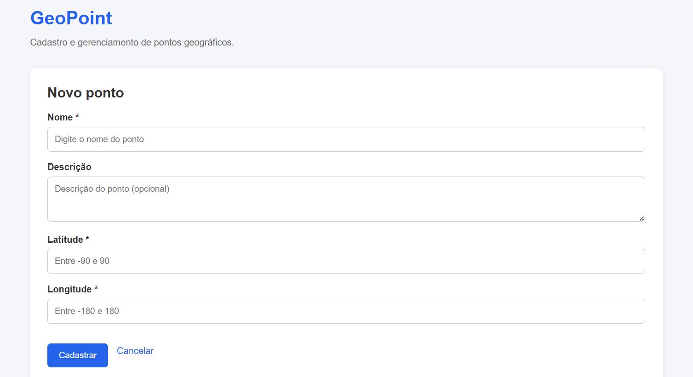
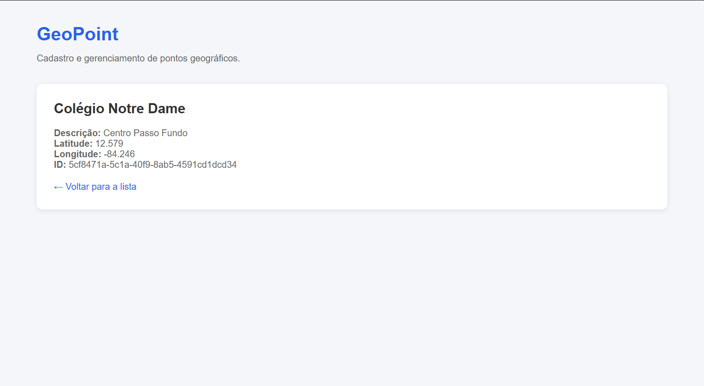
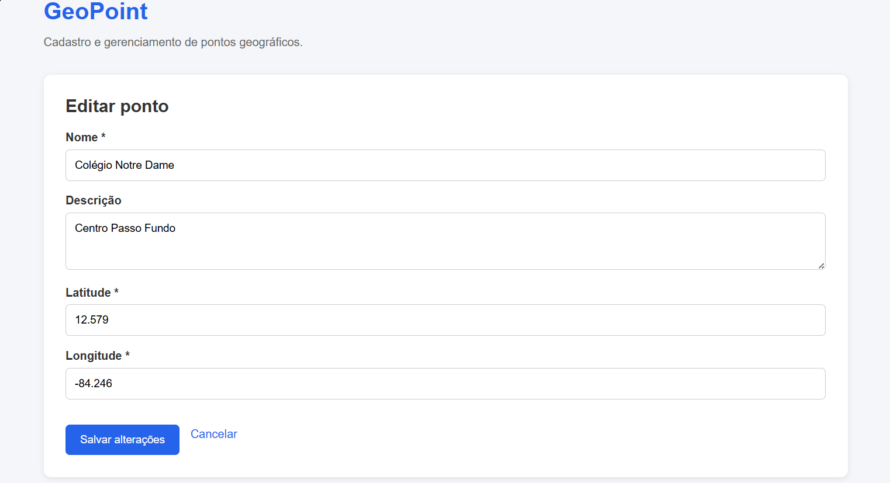

# GeoPoint — Trabalho G2

Projeto desenvolvido para a disciplina de **Desenvolvimento Frontend**, da Atitus Educação.

O GeoPoint é uma aplicação web para cadastrar, consultar, editar e excluir pontos geográficos, utilizando uma API REST.

## Integrantes

- Adrian Lemos
- Henrique Segala

## Tecnologias utilizadas

- HTML5
- CSS3
- JavaScript puro
- API REST
- Git e GitHub

## Sobre o projeto

O sistema permite gerenciar pontos geográficos por meio de uma interface web. Os dados são armazenados e consultados através da GeoPoint API.

Cada ponto possui nome, descrição, latitude, longitude e um identificador único (ID), gerado automaticamente pela API.

## Funcionalidades

- Cadastro de novos pontos geográficos.
- Listagem dos pontos cadastrados.
- Pesquisa por nome ou descrição.
- Visualização dos detalhes de cada ponto.
- Edição dos dados cadastrados.
- Exclusão de pontos com confirmação.
- Validação dos campos obrigatórios.
- Aceitação de coordenadas com casas decimais.
- Menu de navegação presente em todas as telas.

## API utilizada

**URL base:**

https://geopoint-6x4u.onrender.com

**Recurso utilizado:**

`/api/points`

| Método | Operação |
|---|---|
| GET | Listar pontos |
| GET | Consultar ponto por ID |
| POST | Cadastrar ponto |
| PUT | Atualizar ponto |
| DELETE | Excluir ponto |

Os dados são enviados e recebidos no formato JSON.

## Validações

O formulário possui as seguintes validações:

- Nome obrigatório, com até 100 caracteres.
- Descrição opcional, com até 255 caracteres.
- Latitude entre -90 e 90.
- Longitude entre -180 e 180.
- Conversão das coordenadas para números antes do envio à API.

## Como executar o projeto

1. Baixe ou clone o repositório do GitHub.
2. Abra a pasta do projeto no Visual Studio Code.
3. Instale a extensão Live Server, caso ainda não tenha.
4. Abra o arquivo `index.html`.
5. Clique com o botão direito e selecione **Open with Live Server**.
6. A aplicação será aberta no navegador.

É necessário ter conexão com a internet para acessar a API.

## Organização dos arquivos

```text
Trabalho-G2-GeoPoint/
│
├── index.html
├── formulario.html
├── ponto.html
│
├── style.css
│
├── api.js
├── componentes.js
├── script.js
├── formulario.js
└── detalhe.js
```

Cada arquivo possui uma responsabilidade dentro da aplicação:

- `index.html`: tela principal e listagem dos pontos.
- `formulario.html`: tela de cadastro e edição.
- `ponto.html`: tela de detalhes.
- `style.css`: estilos e aparência das páginas.
- `api.js`: comunicação com a API.
- `componentes.js`: funções reutilizáveis da interface.
- `script.js`: listagem, pesquisa e exclusão de pontos.
- `formulario.js`: criação, edição e validação dos dados.
- `detalhe.js`: busca e apresentação dos dados de um ponto.

## Capturas de tela

As imagens abaixo apresentam as principais telas da aplicação.

### 1. Listagem de pontos



### 2. Filtro de pontos



### 3. Cadastro de ponto



### 4. Detalhes do ponto



### 5. Edição de ponto



## Repositório

Código-fonte disponível no GitHub:

https://github.com/AdrianLemos-ops/Trabalho-G2-GeoPoint

---

**Atitus Educação — Ciência da Computação**

Trabalho G2 — Desenvolvimento Frontend